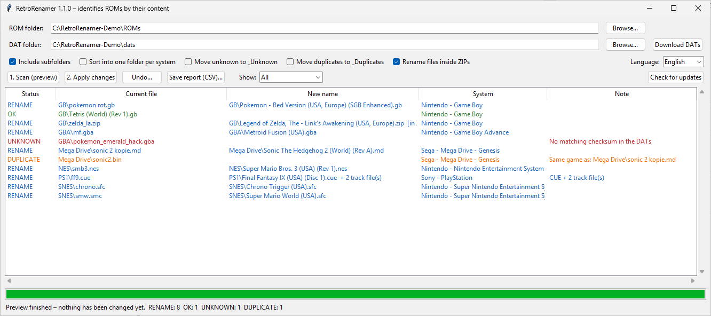

# RetroRenamer

[](https://github.com/phillhf/RetroRenamer/actions/workflows/tests.yml)
[](https://github.com/phillhf/RetroRenamer/releases/latest)
[](LICENSE)

**Identify retro game ROMs by their content, not their file name, and rename them to their correct, official names.**

`pkmn_red_FINAL(2).gb` → `Pokemon - Red Version (USA, Europe) (SGB Enhanced).gb`

[🇩🇪 Deutsche Anleitung](README_de.md)



---

## How it works

Every ROM dump has a unique fingerprint: its checksum (CRC32 / SHA1).
Preservation groups such as **No-Intro** and **Redump** publish free databases called **DAT files**. They list the
correct name and checksum of every known dump.

RetroRenamer calculates the checksum of each of your files and looks it up in those DAT files.
**The old file name is never used for identification.** A file named `asdf.zip` is recognized just as well as one with a
perfect name.

> **RetroRenamer does not include any DAT files and no ROMs.** You download the DAT files yourself, for free.
> See [step 2](#2-download-the-dat-files).

## Features

- **Many systems in one run**: Game Boy, Game Boy Color, GBA, NES, SNES, N64, Nintendo DS, Mega Drive/Genesis,
  Master System, Game Gear, PlayStation and every other system with a No-Intro or Redump DAT
- **Scans subfolders**: point it at your whole `ROMs` folder
- **Handles headers and odd formats automatically**:
  - NES (iNES) and FDS headers, SNES copier headers, Atari Lynx and 7800 headers
  - Mega Drive `.smd` (interleaved) files
  - N64 `.v64` (byte-swapped) and `.n64` (little-endian) files
- **CD images with several tracks** (`.cue` + `.bin`): all tracks are identified together and renamed together, and
  the `.cue` file is updated to the new track names
- **Archives**:
  - `.zip`: renames the archive *and* the files inside it
  - `.7z` and `.rar`: need [7-Zip](https://www.7-zip.org/) to be installed. The archive is renamed, but the files inside are not.
  - Large files inside archives are read piece by piece, so even multi-GB disc images in a ZIP use little memory
- **Fast**: checks several files in parallel
- **Preview first**: nothing is changed until you click *Apply changes*
- **Full undo**: every change is logged, and one click restores the original names
- **Finds duplicates and unknown files**, and can move them into `_Duplicates` / `_Unknown`
- **Optional sorting** into one folder per system
- For unknown ROMs it shows the **internal title from the ROM header** as a hint
- **English and German**: the language is detected automatically and can be switched in the program
- **Built-in updater**: updates itself directly from GitHub
- Available as a **Windows EXE** (no installation needed) or as a Python script (Windows, Linux, macOS)

---

## 1. Installation

### Option A: Windows EXE (easiest)

1. Open the **[latest release](https://github.com/phillhf/RetroRenamer/releases/latest)** and download **`RetroRenamer.exe`**.
2. Create a folder for it, e.g. `C:\Tools\RetroRenamer`, and put the EXE there. RetroRenamer stores its `dats` folder
   and settings next to the EXE.
3. Double-click `RetroRenamer.exe`.

> ⚠️ **Windows SmartScreen** may warn you the first time ("Windows protected your PC"), because the EXE is not
> digitally signed. Click **More info → Run anyway**. The EXE is built automatically by GitHub from the source code
> in this repository ([build workflow](.github/workflows/release.yml)).

### Option B: Python (Windows, Linux, macOS)

1. Install **Python 3.9 or newer** from [python.org](https://www.python.org/downloads/).
   On Windows, tick **"Add python.exe to PATH"** in the installer.
2. Download the **[latest release](https://github.com/phillhf/RetroRenamer/releases/latest)** (*Source code (zip)*)
   and unzip it, or run:
   ```bash
   git clone https://github.com/phillhf/RetroRenamer.git
   ```
3. Start it:
   - **Windows:** double-click **`RetroRenamer starten.bat`**
   - **Linux / macOS:** `python3 retrorenamer_gui.py`

### Optional: 7-Zip

Install [7-Zip](https://www.7-zip.org/) if you want `.7z` and `.rar` archives to be recognized.
On Linux, install the `p7zip-full` or `7zip` package. On macOS, run `brew install sevenzip`.

---

## 2. Download the DAT files

This is the most important step. **Without DAT files, RetroRenamer cannot recognize anything.**
You only need to do it once. Repeat it from time to time to get newly added games.

> 💡 In RetroRenamer, the **No-Intro DATs (website)** button opens the No-Intro download page and your DAT folder.
> Redump DATs can be downloaded directly with **Get Redump DATs...** (see below).

### Cartridge and handheld systems: No-Intro (recommended)

No-Intro covers almost all cartridge-based and handheld systems: GB, GBC, GBA, NES, SNES, N64, DS, Mega Drive and many more.

**Easiest way: download the complete daily pack (all systems at once)**

1. Open the No-Intro **DAT-o-MATIC** download page:
   **https://datomatic.no-intro.org/index.php?page=download&s=64&op=daily**
   (or go to https://datomatic.no-intro.org → menu **Download** → **Daily**)
2. Leave **Type: DAT** and **Set: No-Intro** selected.
3. Click **Request**. When the pack is ready, a download button appears. Click it to download the ZIP file.
4. Put the downloaded **ZIP file** into RetroRenamer's **`dats`** folder. **There is no need to unzip it.**

**Alternative: download only the systems you need.** On DAT-o-MATIC choose **Download → Standard DAT**, select a
system and download its `.dat` file. Put it into the `dats` folder as well.

### Which DAT do I need for my system?

If you use the complete daily pack, you already have all of them. The names below are how the DATs are called on DAT-o-MATIC:

| Your ROMs | DAT name on DAT-o-MATIC |
|---|---|
| Game Boy (`.gb`) | `Nintendo - Game Boy` |
| Game Boy Color (`.gbc`) | `Nintendo - Game Boy Color` |
| Game Boy Advance (`.gba`) | `Nintendo - Game Boy Advance` |
| NES (`.nes`) | `Nintendo - Nintendo Entertainment System (Headered)` **or** `(Headerless)`, either one works |
| Famicom Disk System (`.fds`) | `Nintendo - Family Computer Disk System` |
| SNES (`.sfc`, `.smc`) | `Nintendo - Super Nintendo Entertainment System` |
| Nintendo 64 (`.z64`, `.v64`, `.n64`) | `Nintendo - Nintendo 64 (BigEndian)`, which also matches `.v64`/`.n64` files |
| Nintendo DS (`.nds`) | `Nintendo - Nintendo DS (Decrypted)` |
| Virtual Boy (`.vb`) | `Nintendo - Virtual Boy` |
| Mega Drive / Genesis (`.md`, `.gen`, `.bin`, `.smd`) | `Sega - Mega Drive - Genesis` |
| Master System (`.sms`) | `Sega - Master System - Mark III` |
| Game Gear (`.gg`) | `Sega - Game Gear` |
| 32X (`.32x`) | `Sega - 32X` |
| Atari 2600 / 7800 / Lynx | `Atari - Atari 2600`, `Atari - Atari 7800 (A78)`, `Atari - Atari Lynx (LNX)` |
| WonderSwan (Color) | `Bandai - WonderSwan`, `Bandai - WonderSwan Color` |
| Neo Geo Pocket Color | `SNK - NeoGeo Pocket Color` |

### Disc-based systems: Redump

For CD/DVD systems (PlayStation, PS2, PSP, Saturn, Dreamcast, Mega-CD, GameCube, ...) RetroRenamer can download the
DATs for you:

1. Click **Get Redump DATs...**
2. Select your systems (click to select several) and click **Download**.

The files are downloaded from redump.org into your `dats` folder, and older versions are replaced. To go easy on
Redump's servers, RetroRenamer waits 5 seconds between two downloads and only downloads when you ask it to.
Your selection is remembered, so updating later is just two clicks.

On the command line: `python retrorenamer.py --redump psx,ps2`. Run `--redump list` to see all system codes.

You can also download them manually from **http://redump.org/downloads/**: click **Datfile** next to the system and
put the file into the `dats` folder.

Supported disc formats:
- `.cue` + one or more `.bin` tracks (e.g. PlayStation, Saturn, Mega-CD)
- single-file images such as `.iso` (e.g. PS2, PSP, GameCube)

> ⚠️ Compressed disc formats (`.chd`, `.rvz`, `.cso`, `.pbp`) and `.gdi` are **not** supported. Redump checksums refer
> to the uncompressed data, so these files would first have to be converted back.

### Keeping the DATs up to date

Download a new pack from time to time and replace the old files in the `dats` folder. RetroRenamer detects the change
automatically and rebuilds its internal cache on the next scan.

---

## 3. Usage

1. **ROM folder**: choose the folder with your ROMs, e.g. `C:\ROMs`. Subfolders are included.
2. **DAT folder**: the `dats` folder is preselected.
3. Click **1. Scan (preview)**. Nothing is changed yet. The list shows the current and the new name of every file.
4. Check the list, then click **2. Apply changes**.
5. Changed your mind? Click **Undo...** and select the `retrorenamer_undo_<date>.csv` file in your ROM folder.

**Options:**

| Checkbox | Meaning |
|---|---|
| Include subfolders | Scan subfolders too (default: on) |
| Sort into one folder per system | Move files into one folder per system, e.g. `Nintendo - Game Boy\` (default: off, so files stay where they are) |
| Move unknown to _Unknown | Move unrecognized files into `_Unknown` |
| Move duplicates to _Duplicates | Move duplicates into `_Duplicates` |
| Rename files inside ZIPs | Also rename the files inside ZIP archives (default: on) |

### Command line

```bash
python retrorenamer.py "D:\ROMs"                     # preview only, changes nothing
python retrorenamer.py "D:\ROMs" --apply             # rename
python retrorenamer.py "D:\ROMs" --apply --sort      # rename and sort into one folder per system
python retrorenamer.py --undo "D:\ROMs\retrorenamer_undo_20261019_120000.csv"
```

| Option | Meaning |
|---|---|
| `--dats FOLDER` | DAT folder (default: `./dats`) |
| `--apply` | Actually perform the changes (otherwise preview only) |
| `--no-recursive` | Do not scan subfolders |
| `--sort` | Sort into one folder per system |
| `--move-unknown` | Move unknown files to `_Unknown` |
| `--move-duplicates` | Move duplicates to `_Duplicates` |
| `--no-zip-inner` | Do not rename files inside ZIP archives |
| `--report FILE.csv` | Save a CSV report with all checksums |
| `--workers N` | Number of files checked in parallel (default: automatic) |
| `--lang de\|en` | Output language (default: system language) |
| `--undo UNDO.csv` | Undo a previous run |
| `--redump psx,ps2` | Download Redump DATs into the DAT folder (`--redump list` shows all codes) |
| `--update` | Install the latest version from GitHub |

---

## Updating

RetroRenamer checks for a new version on GitHub every time it starts. If one is available, it asks you whether to
install it. You can also click **Check for updates**, or run `python retrorenamer.py --update`.

- **EXE version:** the new `RetroRenamer.exe` is downloaded and replaces the old one.
- **Python version:** the program files are replaced.

**Your DAT files and settings are always kept.** If you installed RetroRenamer with `git clone`, update with `git pull` instead.

---

## Status meanings

| Status | Meaning |
|---|---|
| **OK** | The file already has the correct name |
| **RENAME** | Recognized, will be renamed |
| **UNKNOWN** | The checksum is not in any DAT (see [FAQ](#faq)) |
| **DUPLICATE** | The same game already exists under its correct name |
| **MIXED** | The archive or CUE contains files from several different games and is left untouched |
| **ERROR** | The file could not be read, or files referenced by a `.cue` are missing |

---

## FAQ

**A ROM shows up as UNKNOWN. Why?**
- The DAT for that system is missing from the `dats` folder.
- The ROM is a **hack, translation, homebrew or prototype**. These are not part of the No-Intro main DATs.
- The ROM is a **bad dump** or has been **modified** (patched, trimmed, overdumped).
- **Nintendo DS:** *trimmed* ROMs (unused space removed to save disk space) have a different checksum and cannot be recognized.

For unknown files RetroRenamer shows the internal title from the ROM header, if it can read one. This tells you what
the file probably is.

**Why not just use the file name?**
File names are often wrong, shortened or in another language. The checksum is the only reliable way to know exactly
which version (region, revision) you have.

**Is it safe?**
Nothing happens before you confirm. Every change is written to an undo file immediately, so you can always go back.
For the very first run on a large collection, we still recommend testing it on a copy.

**How much memory does it need?**
With the complete No-Intro daily pack, expect around 300 MB of RAM. Loading the DATs takes a few seconds the first
time and is faster afterwards thanks to a cache.

**Where do the names come from?**
Directly from the DAT files. RetroRenamer uses exactly the names published by No-Intro / Redump.

---

## Limitations

- Compressed disc formats (`.chd`, `.rvz`, `.cso`, `.pbp`) and `.gdi` are not supported.
- `.7z` and `.rar` archives: only the archive itself is renamed, not the files inside.

## Why are No-Intro DATs not downloaded automatically?

No-Intro's data license allows free use of the DATs. However, their download page is designed as a manual process
(a request form), and their `robots.txt` asks for at most one request every 5 seconds. To respect the volunteer-run
project, RetroRenamer only opens their download page. Redump offers a direct download link for every system, so
RetroRenamer can download those for you.

## Development

Run the tests. They create artificial ROMs and DATs, so no real ROMs are needed:

```bash
python tests/test_retrorenamer.py
```

Build the Windows EXE yourself:

```bash
pip install pyinstaller
python -m PyInstaller --onefile --windowed --name RetroRenamer retrorenamer_gui.py
```

Every published release automatically gets a `RetroRenamer.exe` built by GitHub Actions.

## Legal

RetroRenamer is a file management tool. It does **not** contain, download or link to any ROMs.
DAT files are provided by the [No-Intro](https://no-intro.org) and [Redump](http://redump.org) projects. Please respect
their terms of use. Only use ROMs you are legally allowed to own.

## License

[MIT](LICENSE) © Phill (phillhf)
