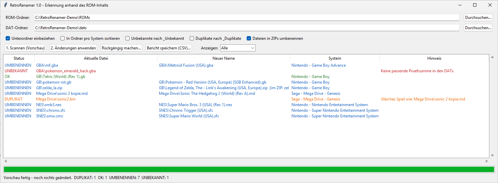

# RetroRenamer

**Erkennt Retro-Spiele-ROMs anhand ihres Inhalts statt am Dateinamen und benennt sie mit dem korrekten, offiziellen Namen um.**

`pkmn_rot_FINAL(2).gb` → `Pokemon - Rote Edition (Germany) (SGB Enhanced).gb`

[🇬🇧 English version](README.md)



---

## So funktioniert es

Jedes ROM hat einen eindeutigen Fingerabdruck: seine Prüfsumme (CRC32 / SHA1).
Archivierungsprojekte wie **No-Intro** und **Redump** veröffentlichen kostenlos sogenannte **DAT-Dateien**. Darin
stehen für jedes bekannte Spiel der korrekte Name und die Prüfsumme.

RetroRenamer berechnet die Prüfsumme jeder deiner Dateien und sucht sie in diesen DAT-Dateien.
**Der alte Dateiname wird für die Erkennung nie verwendet.** Eine Datei namens `asdf.zip` wird genauso erkannt wie eine
mit perfektem Namen.

> **RetroRenamer enthält keine DAT-Dateien und keine ROMs.** Die DAT-Dateien lädst du selbst kostenlos herunter,
> siehe [Schritt 1](#1-dat-dateien-herunterladen).

## Funktionen

- **Viele Systeme in einem Durchgang**: Game Boy, Game Boy Color, GBA, NES, SNES, N64, Nintendo DS,
  Mega Drive/Genesis, Master System, Game Gear und jedes weitere System mit einer No-Intro- oder Redump-DAT
- **Durchsucht Unterordner**: Du kannst einfach deinen kompletten `ROMs`-Ordner auswählen.
- **Header und Sonderformate werden automatisch berücksichtigt**:
  - NES- (iNES) und FDS-Header, SNES-Kopierer-Header, Atari-Lynx- und 7800-Header
  - Mega-Drive-Dateien im `.smd`-Format (interleaved)
  - N64-Dateien in `.v64`- (byteswapped) und `.n64`-Byteorder (little endian)
- **ZIP-Unterstützung**: benennt das Archiv *und* die Datei darin um
- **7z-Unterstützung**: braucht ein installiertes [7-Zip](https://www.7-zip.org/) und funktioniert nur bei Archiven mit einer einzigen Datei
- **Erst Vorschau**: Es wird nichts geändert, bevor du auf *Anwenden* klickst.
- **Vollständiges Rückgängigmachen**: Jede Änderung wird protokolliert, ein Klick stellt die alten Namen wieder her.
- **Erkennt Duplikate und unbekannte Dateien** und verschiebt sie auf Wunsch nach `_Duplikate` / `_Unbekannt`
- **Optional: Sortieren** in einen Ordner pro System
- Bei unbekannten ROMs wird der **interne Titel aus dem ROM-Header** als Hinweis angezeigt.
- **Eingebaute Update-Funktion**: aktualisiert sich mit einem Klick direkt von GitHub
- Grafische Oberfläche und Kommandozeile
- Außer Python selbst ist nichts weiter nötig.

---

## Installation

1. **Python 3.8 oder neuer** von [python.org](https://www.python.org/downloads/) installieren.
   Unter Windows im Installer **„Add python.exe to PATH“** anhaken.
2. Die neueste Version von der **[Releases-Seite](https://github.com/phillhf/RetroRenamer/releases/latest)** herunterladen
   (*Source code (zip)*) und entpacken, oder:
   ```bash
   git clone https://github.com/phillhf/RetroRenamer.git
   ```
3. *(Optional)* [7-Zip](https://www.7-zip.org/) installieren, wenn auch `.7z`-Archive erkannt werden sollen.

---

## 1. DAT-Dateien herunterladen

Das ist der wichtigste Schritt. **Ohne DAT-Dateien kann RetroRenamer nichts erkennen.**
Du musst das nur einmal machen. Wiederhole es ab und zu, damit auch neu erfasste Spiele erkannt werden.

### Modul- und Handheld-Systeme: No-Intro (empfohlen)

No-Intro deckt fast alle Systeme mit Steckmodulen sowie Handhelds ab: GB, GBC, GBA, NES, SNES, N64, DS, Mega Drive und viele mehr.

**Am einfachsten: das komplette Tagespaket herunterladen (alle Systeme auf einmal)**

1. Die Download-Seite von No-Intros **DAT-o-MATIC** öffnen:
   **https://datomatic.no-intro.org/index.php?page=download&s=64&op=daily**
   (oder auf https://datomatic.no-intro.org → Menü **Download** → **Daily**)
2. **Type: DAT** und **Set: No-Intro** ausgewählt lassen.
3. Auf **Request** klicken. Sobald das Paket fertig ist, erscheint ein Download-Knopf. Darüber lädst du die ZIP-Datei herunter.
4. Die heruntergeladene **ZIP-Datei** in den Ordner **`dats`** von RetroRenamer legen. **Entpacken ist nicht nötig.**

**Alternative: nur einzelne Systeme herunterladen.** Auf DAT-o-MATIC **Download → Standard DAT** wählen, das
gewünschte System auswählen und die `.dat`-Datei herunterladen. Auch diese kommt in den Ordner `dats`.

### Welche DAT brauche ich für welches System?

Mit dem kompletten Tagespaket hast du automatisch alle. So heißen die DATs auf DAT-o-MATIC:

| Deine ROMs | Name der DAT auf DAT-o-MATIC |
|---|---|
| Game Boy (`.gb`) | `Nintendo - Game Boy` |
| Game Boy Color (`.gbc`) | `Nintendo - Game Boy Color` |
| Game Boy Advance (`.gba`) | `Nintendo - Game Boy Advance` |
| NES (`.nes`) | `Nintendo - Nintendo Entertainment System (Headered)` **oder** `(Headerless)`, beide funktionieren |
| Famicom Disk System (`.fds`) | `Nintendo - Family Computer Disk System` |
| SNES (`.sfc`, `.smc`) | `Nintendo - Super Nintendo Entertainment System` |
| Nintendo 64 (`.z64`, `.v64`, `.n64`) | `Nintendo - Nintendo 64 (BigEndian)`, passt auch für `.v64`/`.n64` |
| Nintendo DS (`.nds`) | `Nintendo - Nintendo DS (Decrypted)` |
| Virtual Boy (`.vb`) | `Nintendo - Virtual Boy` |
| Mega Drive / Genesis (`.md`, `.gen`, `.bin`, `.smd`) | `Sega - Mega Drive - Genesis` |
| Master System (`.sms`) | `Sega - Master System - Mark III` |
| Game Gear (`.gg`) | `Sega - Game Gear` |
| 32X (`.32x`) | `Sega - 32X` |
| Atari 2600 / 7800 / Lynx | `Atari - Atari 2600`, `Atari - Atari 7800 (A78)`, `Atari - Atari Lynx (LNX)` |
| WonderSwan (Color) | `Bandai - WonderSwan`, `Bandai - WonderSwan Color` |
| Neo Geo Pocket Color | `SNK - NeoGeo Pocket Color` |

### CD-/DVD-Systeme: Redump

Für Disc-Systeme (PlayStation, PS2, PSP, Saturn, Dreamcast, Mega-CD, GameCube usw.) gibt es die DATs auf
**http://redump.org/downloads/**. Neben dem System auf **Datfile** klicken und die Datei in den Ordner `dats` legen.

> ⚠️ RetroRenamer erkennt nur Disc-Images, die aus **einer einzigen Datei** bestehen (z. B. PS2-/PSP-`.iso` oder
> eine einzelne `.bin`). Spiele mit mehreren Tracks (`.cue` plus mehrere `.bin`-Dateien) werden noch nicht unterstützt.

### DATs aktuell halten

Lade ab und zu ein neues Paket herunter und ersetze damit die alten Dateien im Ordner `dats`. RetroRenamer bemerkt
das automatisch und baut seinen internen Zwischenspeicher beim nächsten Scan neu auf.

---

## 2. Benutzung

### Grafische Oberfläche

- **Windows:** Doppelklick auf **`RetroRenamer starten.bat`**
- **Linux / macOS:** `python3 retrorenamer_gui.py`

Danach:

1. **ROM-Ordner:** den Ordner mit deinen ROMs wählen, z. B. `C:\ROMs`. Unterordner werden mit durchsucht.
2. **DAT-Ordner:** Der Ordner `dats` ist schon voreingestellt.
3. **1. Scannen (Vorschau)** klicken. Es wird noch nichts geändert. Die Liste zeigt für jede Datei den aktuellen und den neuen Namen.
4. Liste prüfen, dann auf **2. Änderungen anwenden** klicken.
5. Doch nicht zufrieden? **Rückgängig machen...** klicken und die Datei `retrorenamer_undo_<Datum>.csv` aus dem ROM-Ordner auswählen.

**Optionen:**

| Häkchen | Bedeutung |
|---|---|
| Unterordner einbeziehen | Unterordner mit durchsuchen (Standard: an) |
| In Ordner pro System sortieren | Dateien in einen Ordner pro System verschieben, z. B. `Nintendo - Game Boy\` (Standard: aus, die Dateien bleiben in ihrem Ordner) |
| Unbekannte nach _Unbekannt | Nicht erkannte Dateien nach `_Unbekannt` verschieben |
| Duplikate nach _Duplikate | Duplikate nach `_Duplikate` verschieben |
| Dateien in ZIPs umbenennen | Auch die Datei innerhalb des ZIP-Archivs umbenennen (Standard: an) |

### Kommandozeile

```bash
python retrorenamer.py "D:\ROMs"                     # nur Vorschau, ändert nichts
python retrorenamer.py "D:\ROMs" --apply             # umbenennen
python retrorenamer.py "D:\ROMs" --apply --sort      # umbenennen und in Ordner pro System sortieren
python retrorenamer.py --undo "D:\ROMs\retrorenamer_undo_20261018_120000.csv"
```

| Option | Bedeutung |
|---|---|
| `--dats ORDNER` | DAT-Ordner (Standard: `./dats`) |
| `--apply` | Änderungen wirklich durchführen (sonst nur Vorschau) |
| `--no-recursive` | Unterordner nicht durchsuchen |
| `--sort` | In einen Ordner pro System sortieren |
| `--move-unknown` | Unbekannte Dateien nach `_Unbekannt` verschieben |
| `--move-duplicates` | Duplikate nach `_Duplikate` verschieben |
| `--no-zip-inner` | Dateien innerhalb von ZIPs nicht umbenennen |
| `--report DATEI.csv` | CSV-Bericht mit allen Prüfsummen speichern |
| `--undo UNDO.csv` | Einen früheren Durchlauf rückgängig machen |

---

## Updates

RetroRenamer prüft bei jedem Start, ob es auf GitHub eine neue Version gibt. Wenn ja, fragt es, ob sie installiert
werden soll. Manuell geht es über den Knopf **Nach Updates suchen** oder per:

```bash
python retrorenamer.py --update
```

Ersetzt werden nur die Programmdateien. **Deine DAT-Dateien und Einstellungen bleiben erhalten.**
Wenn du RetroRenamer per `git clone` installiert hast, aktualisiere stattdessen mit `git pull`.

---

## Bedeutung der Status

| Status | Bedeutung |
|---|---|
| **OK** | Die Datei hat bereits den korrekten Namen. |
| **UMBENENNEN** | Erkannt, wird umbenannt. |
| **UNBEKANNT** | Die Prüfsumme steht in keiner DAT (siehe [FAQ](#faq)). |
| **DUPLIKAT** | Dasselbe Spiel liegt schon unter dem korrekten Namen vor. |
| **GEMISCHT** | Das Archiv enthält mehrere verschiedene Spiele und wird nicht angefasst. |
| **FEHLER** | Die Datei konnte nicht gelesen werden. |

---

## FAQ

**Ein ROM wird als „UNBEKANNT“ angezeigt. Warum?**
- Die DAT für dieses System fehlt im Ordner `dats`.
- Das ROM ist ein **Hack, eine Übersetzung, Homebrew oder ein Prototyp**. Diese sind nicht in den No-Intro-Haupt-DATs enthalten.
- Das ROM ist ein **fehlerhafter Dump (Bad Dump)** oder wurde **verändert** (gepatcht, getrimmt, Overdump).
- **Nintendo DS:** *Getrimmte* ROMs (ungenutzter Speicher entfernt, um Platz zu sparen) haben eine andere Prüfsumme und können nicht erkannt werden.

Bei unbekannten Dateien zeigt RetroRenamer, wenn möglich, den internen Titel aus dem ROM-Header an. Daran siehst du,
um welches Spiel es sich vermutlich handelt.

**Warum nicht einfach den Dateinamen verwenden?**
Dateinamen sind oft falsch, abgekürzt oder in einer anderen Sprache. Nur über die Prüfsumme lässt sich genau sagen,
welche Version (Region, Revision) du hast.

**Ist das sicher?**
Es passiert nichts, bevor du bestätigst. Jede Änderung wird sofort in eine Undo-Datei geschrieben, du kannst also immer
zurück. Beim allerersten Durchlauf über eine große Sammlung empfehlen wir trotzdem, es an einer Kopie zu testen.

**Woher kommen die Namen?**
Direkt aus den DAT-Dateien. RetroRenamer verwendet genau die Namen, die No-Intro bzw. Redump veröffentlichen.

---

## Einschränkungen

- Disc-Images mit mehreren Tracks (`.cue` plus mehrere `.bin`-Dateien) werden nicht unterstützt.
- `.7z`-Archive: nur Archive mit einer einzigen Datei, und nur das Archiv selbst wird umbenannt (nicht die Datei darin).
- `.rar`-Archive werden nicht unterstützt.

## Tests ausführen

Die Tests erzeugen künstliche ROMs und DATs, echte ROMs sind also nicht nötig:

```bash
python tests/test_retrorenamer.py
```

## Rechtliches

RetroRenamer ist ein Werkzeug zur Dateiverwaltung. Es enthält **keine** ROMs, lädt keine herunter und verlinkt auf keine.
Die DAT-Dateien stammen von den Projekten [No-Intro](https://no-intro.org) und [Redump](http://redump.org). Bitte
beachte deren Nutzungsbedingungen. Verwende nur ROMs, die du rechtmäßig besitzen darfst.

## Lizenz

[MIT](LICENSE) © Phill (phillhf)
